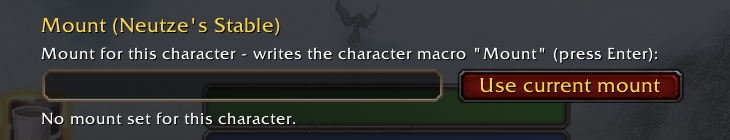

# Neutze's Stable

One mount per character for **World of Warcraft: Forever**, on one button.

Type the mount for this character: `/stable Swift Palomino`, or use Options > AddOns > Neutze's Pantry > Neutze's Stable. It writes a character macro **NPstMount** that mounts that mount, or dismounts you if you're mounted. "Use current mount" takes the mount you're sitting on. Change the name and the macro updates.

- Partial names work (`/stable palomino`).
- Macro changes wait until combat ends.
- **Requires [Neutze's Pantry](https://github.com/neutze/wow-neutze-pantry)**: install it too. This add-on's options page sits under Neutze's Pantry. The field also shows at the bottom of `/np`.

## Install
CurseForge app, or download `NeutzeStable-v0.0.1.zip` from [Releases](https://github.com/neutze/wow-neutze-stable/releases) into `World of Warcraft/_forever_/Interface/AddOns/`.

Part of the **Neutze's** suite: [Pantry](https://github.com/neutze/wow-neutze-pantry) · [Companion](https://github.com/neutze/wow-neutze-companion) · [Macros](https://github.com/neutze/wow-neutze-macros)

## License
MIT
